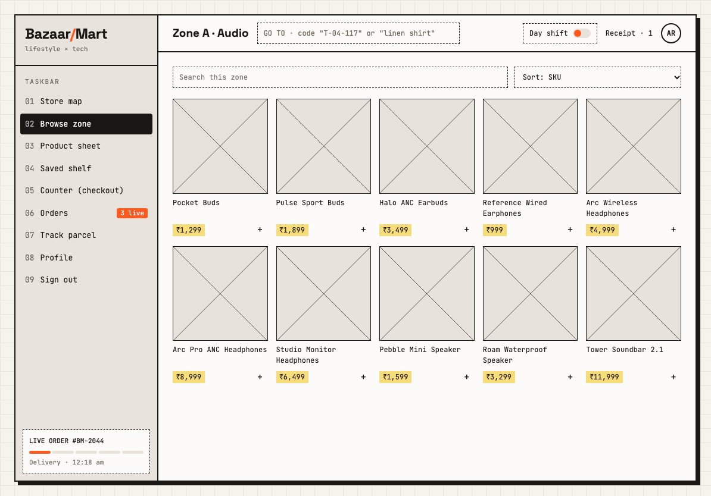

# BazaarMart

**lifestyle × tech.** A full-stack MERN shopping website built for the CS3801 Web Technologies Lab. It combines Exercise 8 (the shopping application with JWT login) with the CRUD API pattern from Exercise 7, applied to products.

> **Rebuild in progress.** This README describes what works today. The target design is in [docs/DESIGN.md](docs/DESIGN.md), with wireframes in [docs/wireframe/](docs/wireframe/). The look and pages will change as each step lands.

- Register, log in and manage your profile
- Browse, search, filter and sort the catalogue
- Add items to a cart, place an order and view order history
- Manage products as an admin

**Stack:** MongoDB, Express 5, React 18, Node.js, Mongoose 8, Vite, React Router 7, JWT, bcrypt, plain CSS.



## Getting started

You need Node.js 20 or later and a MongoDB Atlas connection string (or a local MongoDB server).

```bash
npm run install:all
cp backend/.env.example backend/.env
cp frontend/.env.example frontend/.env
```

Fill in `backend/.env`:

| Variable | Required | Purpose |
|---|---|---|
| `MONGO_URI` | Yes | MongoDB connection string. Data is always stored in the `bazaarmart` database. |
| `JWT_SECRET` | Yes | Long random string used to sign login tokens |
| `JWT_EXPIRES_IN` | No | How long a login lasts, default `2h` |
| `SEED_ADMIN_EMAIL` | For seeding | Email of the admin account |
| `SEED_ADMIN_PASSWORD` | For seeding | Password of the admin account, at least 6 characters |
| `SEED_DEMO_EMAIL`, `SEED_DEMO_PASSWORD` | No | Sign-in details for the demo user |
| `NODE_ENV` | No | Set to `production` when deployed |
| `PORT` | No | API port, default `5000` |
| `CLIENT_ORIGIN` | No | Frontend URL allowed by CORS, default `http://localhost:5173` |
| `DNS_SERVERS` | No | Comma-separated DNS servers, only if MongoDB SRV lookups fail on your network |

`OTP_MOCK=true` turns on the mock SMS provider, which prints sign-in codes to the server console. No real SMS provider is connected, so phone sign-in returns 503 without it. Product data is public by default. `REQUIRE_AUTH_FOR_CATALOGUE=true` makes the product list, category, product sheet, search and kit detail routes return 401 without a token, which restores the lab rule that products need a login.

Then seed the database and start both apps:

```bash
npm run seed    # syncs indexes, then adds zones, kits, the catalogue, the admin and a demo user
npm run dev     # API on :5000, website on http://localhost:5173
```

The seed is safe to re-run. It adds only what's missing, so product edits and stock levels are kept, and an existing admin keeps their password. Changing `SEED_ADMIN_PASSWORD` later has no effect on that account. If a normal account already holds the admin email, the seed promotes it and replaces its password.

The demo user (`SEED_DEMO_EMAIL`, `SEED_DEMO_PASSWORD`) gets a saved address and two orders, one out for delivery and one packed. It's skipped if those settings are blank. The catalogue lives in `backend/data/catalogue.js`, with invented brands. Product images are generated SVGs in `backend/public/products`: run `npm run images --prefix backend` after changing the catalogue, then `npm run seed --prefix backend` to refresh them in the database.photos.

If port 5000 is already in use on macOS, AirPlay Receiver is the usual cause. Set `PORT` in `backend/.env` and `VITE_API_URL` in `frontend/.env` to another port.

## Commands

Run these from the project root.

| Command | What it does |
|---|---|
| `npm run install:all` | Installs root, backend and frontend packages |
| `npm run dev` | Starts the API and the website together |
| `npm run seed` | Adds whatever is missing from the zones, kits, catalogue, admin and demo user |
| `npm test` | Runs the automated tests on temporary in-memory databases |
| `npm run build` | Builds the website into `frontend/dist` |
| `npm start` | Starts the API without auto-reload |

## Website pages

| Route | Page | Access |
|---|---|---|
| `/` | Opens the store map | Public |
| `/map` | Store map: tiles sized by stock, peek panel, new-drops conveyor, kits | Public |
| `/zone/:zoneCode` | Browse a zone: filter dials and shelf, list and bench views, all kept in the URL | Public |
| `/p/:sku` | Product sheet: gallery, specs, colours, add, bench, save, fits with, reviews, Q&A | Public |
| `/saved` | Saved shelf (placeholder for now) | Logged in |
| `/counter` | Counter: three-step checkout on one screen, with a server-priced receipt | Public, guests allowed |
| `/orders` | Order history | Logged in |
| `/track/:orderNo` | Track parcel (placeholder for now) | Public, guests check by phone |
| `/profile` | Account settings: personal details (PATCH), password (PUT), delete account (DELETE) | Logged in |
| `/signin` | Phone OTP first, then email login or registration. Google shows that it isn't configured | Public |
| `/s/:shareId` | Shared shelf (placeholder for now) | Public |
| `/admin/products` | Add, edit and delete products | Admin |

`/login` and `/register` redirect to `/signin`. Every page sits in the same shell: the numbered Taskbar, a top bar with the GO TO box (press `/` to focus it), the Day and Night shift toggle, and the receipt drawer. The theme follows your system until you choose one. Guests keep a receipt in the browser, and it joins your account's receipt when you sign in.

Checkout places a real order and reduces stock, but no payment is taken: UPI, card and netbanking show a simulated confirmation, and no payment details are ever asked for.

Add to the receipt with the `+` on any product, from the product sheet, or by dragging a conveyor card onto **Receipt** in the top bar (mouse or pen; on touch, use `+`). Sign-in by phone needs `OTP_MOCK=true` in `backend/.env`; outside production the code appears on screen and in the server log. The bench holds up to four products and stays in the browser.

## API

The base URL is `/api`. Every response uses this shape, except 204 responses, which have no body:

```json
{ "success": true, "message": "...", "data": {}, "count": 0 }
```

Protected routes need the header `Authorization: Bearer <token>`.

`GET /api/health` needs no login and returns `{ "success": true }`. Use it to check the API is up.

### Users

| Method | Path | Access | Result |
|---|---|---|---|
| POST | `/api/users` | Public | Register: 201, 400, 409 |
| POST | `/api/login` | Public | Returns `data.token` and `data.user`: 200, 400, 401, 404 |
| GET | `/api/users/me` | Logged in | Current user |
| PUT | `/api/users?emailId=` | Own account | Full update; needs `username`, `age` and `password` |
| PATCH | `/api/users?emailId=` | Own account | Any of `username`, `age`, `password` |
| DELETE | `/api/users?emailId=` | Own account | Delete account: 204 |

### Phone sign-in

| Method | Path | Access | Result |
|---|---|---|---|
| POST | `/api/auth/otp/request` | Public | `{ "phone": "+919876543210" }`. Sends a 6-digit code valid for 5 minutes; returns it as `data.devCode` outside production. Limited to 5 requests per 10 minutes, per phone and per IP |
| POST | `/api/auth/otp/verify` | Public | `{ "phone", "code" }`. Returns `data.token` and `data.user`, creating the account if new: 200, 400 expired, 401 wrong code, 429 after 5 wrong attempts |
| POST | `/api/auth/google` | Public | 501 until Google sign-in is configured |

### Account details

All of these need a login and affect only your own account.

| Method | Path | Result |
|---|---|---|
| GET, POST | `/api/users/me/addresses` | List, or add: 201. Only one address is the default at a time |
| PUT, DELETE | `/api/users/me/addresses/:id` | Update fields sent: 200, or delete: 204 |
| GET, POST | `/api/users/me/devices` | List, or add: 201 |
| PUT, DELETE | `/api/users/me/devices/:id` | Update fields sent: 200, or delete: 204 |
| GET, PATCH | `/api/users/me/prefs` | Read, or change only the preferences sent |

### Products

| Method | Path | Access | Result |
|---|---|---|---|
| GET | `/api/products` | Public | List with `count`, sorted by `productId` |
| GET | `/api/products/sheet/:productId` | Public | `data.product` and up to 3 `data.related`; 404 if unknown |
| GET | `/api/products/:category` | Public | Case-insensitive category filter; 404 if none |
| POST | `/api/products` | Admin | Create: 201, duplicate `productId` 409 |
| PUT | `/api/products?productId=` | Admin | Update: 200, 404 |
| DELETE | `/api/products?productId=` | Admin | Delete: 204, 404 |

Both GET routes also accept:

| Parameter | Effect |
|---|---|
| `q` | Search by product name, brand or category |
| `zone`, `brand`, `colour`, `use` | Match any of a comma-separated list, in any case |
| `bay` | Bay number |
| `minPrice`, `maxPrice` | Price range |
| `connectivity` | `wired`, `wireless` or `n/a` |
| `isNew` | `true` or `false` |
| `sort` | `price_asc`, `price_desc`, `new` or `name`; default is `productId` |
| `page`, `limit` | Paginate (`limit` is at most 50) and add a `pagination` object to the response |

### Store browsing

| Method | Path | Access | Result |
|---|---|---|---|
| GET | `/api/zones` | Public | Each zone with `productCount`, `totalStock`, `bays` and `layout` |
| GET | `/api/search?q=` | Public | Exact SKU first, then matches by name, brand or zone; at most 8; 400 without `q` |
| GET | `/api/kits` | Public | All kits |
| GET | `/api/kits/:id` | Public | `data.kit` and `data.products` |

### Reviews and questions

| Method | Path | Access | Result |
|---|---|---|---|
| GET | `/api/products/:productId/reviews` | Public | Reviews with the writer's username |
| POST | `/api/products/:productId/reviews` | Logged in | `{ "rating", "text" }`: 201; one per user per product, otherwise 409 |
| GET | `/api/products/:productId/questions` | Public | Questions and any answers |
| POST | `/api/products/:productId/questions` | Logged in | `{ "text" }`: 201 |

### Orders

| Method | Path | Access | Result |
|---|---|---|---|
| POST | `/api/orders` | Public or logged in | Place an order: 201, 400, 404, 409 if stock is short |
| POST | `/api/orders/quote` | Public | `{ "items", "coupon" }`. Prices a receipt from the database without saving anything or reserving stock: 200, 400, 404, 409 |
| GET | `/api/orders?status=` | Logged in | Your orders, newest first. `status` is `live`, `delivered`, `returns` or `cancelled` |
| GET | `/api/orders/:orderNo` | Owner or admin | One order |
| GET | `/api/orders/:orderNo/track` | Owner or admin | Events, ETA window and courier, plus the delivery OTP for the owner once out for delivery |
| PATCH | `/api/orders/:orderNo` | Owner | `{ "slot" }`, `{ "leaveAtDoor", "deliveryNote" }` or `{ "cancel": true }`. Cancelling works only before shipping and restores stock |
| PATCH | `/api/admin/orders/:orderNo/status` | Admin | `{ "status" }`, one step at a time: 200, 400, 404, 409 |

A checkout body looks like this. Logged-in customers leave out `guest`; for guests it needs a name and phone. On guest orders, pass `?phone=` with the number used at checkout.

```json
{
  "items": [{ "productId": "A-01-117", "qty": 1, "colour": "Sand" }],
  "address": { "name": "Asha", "phone": "9876543210", "line1": "221B Lake Road", "city": "Chennai", "state": "Tamil Nadu", "pincode": "600001" },
  "slot": { "label": "Tomorrow" },
  "payment": { "method": "upi" },
  "coupon": "WELCOME10",
  "gift": { "wrap": true, "note": "Happy birthday" },
  "gst": { "invoice": true, "gstin": "33AAAAA0000A1Z5" },
  "guest": { "name": "Asha", "phone": "9876543210", "email": "asha@example.com" }
}
```

`colour` is optional and must be one the product comes in. Two colours of one product stay as two order lines.

Prices and totals are always calculated on the server from the database. Delivery costs ₹49 below ₹999 and is free from ₹999. Coupon codes are `WELCOME10` (10% off, up to ₹500), `BAZAAR200` (₹200 off from ₹1500) and `FREESHIP`. Payment is simulated: UPI, card and netbanking succeed, and COD stays pending until delivery. Card details are never stored.

### Saved shelves

These need a login and work only on your own shelves, except the public share link.

| Method | Path | Result |
|---|---|---|
| GET, POST | `/api/shelves` | List with live prices, or create from `{ "name" }`: 201 |
| GET, PATCH, DELETE | `/api/shelves/:id` | Read, rename, or delete: 204 |
| POST | `/api/shelves/:id/items` | Save `{ "productId" }` at its current price: 201, 409 if already saved |
| DELETE | `/api/shelves/:id/items/:productId` | Remove: 204 |
| GET | `/api/shelves/shared/:shareId` | Public. Shelf name and items, with no owner details |

Each item shows `savedPrice`, `currentPrice` and `percentChange`.

### Status codes

| Code | Meaning |
|---|---|
| 200 / 201 / 204 | OK / created / done with no content |
| 400 | Invalid input or missing query parameter |
| 401 | Missing or invalid token, or wrong password |
| 403 | Not your account, or admin access required |
| 404 | Not found |
| 409 | Duplicate record, or not enough stock |
| 429 | Too many failed attempts or code requests |
| 500 | Server or database error; the message is generic in production and stack traces are never sent |
| 501 / 503 | Google sign-in or SMS sign-in is not configured |

## Testing

`npm test` covers the API, the data models and the seed script on temporary databases, including two buyers trying to take the last unit at once. The first run downloads a temporary MongoDB binary.

`bash docs/api-tests/auth-curl.sh http://localhost:5000/api` checks the sign-in flows with curl, and `docs/api-tests/catalogue-curl.sh` and `docs/api-tests/orders-curl.sh` do the same for the catalogue and for orders (see the top of each file for its arguments). It creates test accounts, so run it against a development database, with `OTP_MOCK=true` and `NODE_ENV` not set to production.

To test by hand, import `docs/api-tests/bazaarmart.postman_collection.json` into Thunder Client or Postman. Run `npm run seed` first, set the `adminEmail` and `adminPassword` collection variables to your `SEED_ADMIN_EMAIL` and `SEED_ADMIN_PASSWORD` values, then run the requests in order. The collection cleans up its test user and product at the end, but one order record remains.

## Deployment

1. Create a MongoDB Atlas cluster and allow your host's IP addresses.
2. Deploy `backend/` to Render or Railway with start command `npm start`. Set `NODE_ENV=production`, `MONGO_URI`, `JWT_SECRET` and `CLIENT_ORIGIN` (your frontend URL).
3. Deploy `frontend/` to Vercel or Netlify with build command `npm run build` and output folder `dist`. Set `VITE_API_URL` to your backend URL followed by `/api`. Add a rewrite that sends all paths to `index.html`, so page refreshes work.
4. Run `npm run seed` once with the production `MONGO_URI`, `SEED_ADMIN_EMAIL` and `SEED_ADMIN_PASSWORD` set.

## Security notes

- Passwords are hashed with bcrypt and never returned by the API.
- Secrets live only in `backend/.env`, which git ignores.
- Registration can't set a role. Admin accounts come only from the seed script.
- Every token is checked against the database, so a deleted account loses access immediately.
- Failed login and registration attempts are limited to 10 per IP address every 15 minutes.
- **Known trade-off:** the login token is stored in `localStorage`, which is simple but can be read by any script that runs on the page (an XSS attack). This is acceptable for a lab project, but a production shop should use httpOnly cookies.

## Project structure

```
backend/
  server.js        connects to the database and starts the API
  app.js           middleware, routes and error handling
  seed.js          sample products and the admin account
  config/          database connection
  models/          User, Product, Order
  middleware/      auth, validation, error handling
  controllers/     request logic
  routes/          URL definitions
  utils/           response helpers
  tests/           automated API tests
frontend/src/
  api/             fetch wrapper
  context/         auth, receipt, theme and notices
  components/      layout (shell), ui and shop pieces
  hooks/           shared data and timing hooks
  pages/           one file per page
  styles/          tokens, base, layout and components
docs/
  api-tests/       Thunder Client / Postman collection
  screenshots/     screenshots of the website
  wireframe/       the 9 design wireframes
  DESIGN.md        UI and feature specification
```

See [CONTEXT.md](CONTEXT.md) for backend foundations and [docs/DESIGN.md](docs/DESIGN.md) for the UI and new features. Section 10 of DESIGN.md settles any differences.
