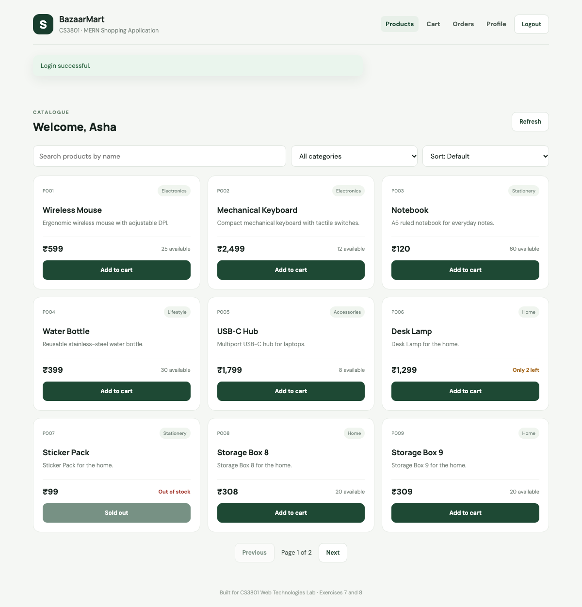

# BazaarMart

**lifestyle × tech.** A full-stack MERN shopping website built for the CS3801 Web Technologies Lab. It combines Exercise 8 (the shopping application with JWT login) with the CRUD API pattern from Exercise 7, applied to products.

> **Rebuild in progress.** This README describes what works today. The target design is in [docs/DESIGN.md](docs/DESIGN.md), with wireframes in [docs/wireframe/](docs/wireframe/). The look and pages will change as each step lands.

- Register, log in and manage your profile
- Browse, search, filter and sort the catalogue
- Add items to a cart, place an order and view order history
- Manage products as an admin

**Stack:** MongoDB, Express 5, React 18, Node.js, Mongoose 8, Vite, JWT, bcrypt.



## Getting started

You need Node.js 20 or later and a MongoDB Atlas connection string (or a local MongoDB server).

```bash
npm install
npm install --prefix backend
npm install --prefix frontend
cp backend/.env.example backend/.env
cp frontend/.env.example frontend/.env
```

Fill in `backend/.env`:

| Variable | Required | Purpose |
|---|---|---|
| `MONGO_URI` | Yes | MongoDB connection string. Data is always stored in the `bazaarmart` database. |
| `JWT_SECRET` | Yes | Long random string used to sign login tokens |
| `SEED_ADMIN_EMAIL` | For seeding | Email of the admin account |
| `SEED_ADMIN_PASSWORD` | For seeding | Password of the admin account, at least 6 characters |
| `PORT` | No | API port, default `5000` |
| `CLIENT_ORIGIN` | No | Frontend URL allowed by CORS, default `http://localhost:5173` |
| `DNS_SERVERS` | No | Comma-separated DNS servers, only if MongoDB SRV lookups fail on your network |

Then seed the database and start both apps:

```bash
npm run seed    # adds sample products (if there are none) and the admin account
npm run dev     # API on :5000, website on http://localhost:5173
```

The seed is safe to re-run. Each run sets the admin account's password back to `SEED_ADMIN_PASSWORD`.

If port 5000 is already in use on macOS, AirPlay Receiver is the usual cause. Set `PORT` in `backend/.env` and `VITE_API_URL` in `frontend/.env` to another port.

## Commands

Run these from the project root.

| Command | What it does |
|---|---|
| `npm run dev` | Starts the API and the website together |
| `npm run seed` | Adds sample products and the admin account |
| `npm test` | Runs the automated API tests on a temporary in-memory database |
| `npm run build` | Builds the website into `frontend/dist` |
| `npm start` | Starts the API without auto-reload |

## Website pages

| Route | Page | Access |
|---|---|---|
| `/` | Home | Public |
| `/register`, `/login` | Account forms | Public |
| `/products` | Catalogue with search, category filter, sorting and pagination | Logged in |
| `/cart` | Cart and checkout | Logged in |
| `/orders` | Order history | Logged in |
| `/profile` | Account settings: personal details (PUT), password (PATCH), delete account (DELETE) | Logged in |
| `/admin/products` | Add, edit and delete products | Admin |

Checkout is a demo: it places a real order and reduces stock, but no payment is taken.

## API

The base URL is `/api`. Every response uses this shape, except 204 responses, which have no body:

```json
{ "success": true, "message": "...", "data": {}, "count": 0 }
```

Protected routes need the header `Authorization: Bearer <token>`.

### Users

| Method | Path | Access | Result |
|---|---|---|---|
| POST | `/api/users` | Public | Register: 201, 400, 409 |
| POST | `/api/login` | Public | Returns `data.token` and `data.user`: 200, 400, 401, 404 |
| PUT | `/api/users?emailId=` | Own account | Full profile update |
| PATCH | `/api/users?emailId=` | Own account | Partial profile update |
| DELETE | `/api/users?emailId=` | Own account | Delete account |

### Products

| Method | Path | Access | Result |
|---|---|---|---|
| GET | `/api/products` | Logged in | List with `count` |
| GET | `/api/products/:category` | Logged in | Case-insensitive category filter; 404 if none |
| POST | `/api/products` | Admin | Create: 201, duplicate `productId` 409 |
| PUT | `/api/products?productId=` | Admin | Update: 200, 404 |
| DELETE | `/api/products?productId=` | Admin | Delete: 204, 404 |

Both GET routes also accept:

| Parameter | Effect |
|---|---|
| `q` | Search by product name |
| `sort` | `price_asc`, `price_desc`, `name` or `newest`; default is `productId` |
| `page`, `limit` | Paginate (`limit` is at most 50) and add a `pagination` object to the response |

### Orders

| Method | Path | Access | Result |
|---|---|---|---|
| POST | `/api/orders` | Logged in | Body `{ "items": [{ "productId": "P001", "qty": 2 }] }`: 201, 400, 404, 409 if stock is short |
| GET | `/api/orders` | Logged in | Your own orders, newest first |

Order totals are always calculated on the server from database prices.

### Status codes

| Code | Meaning |
|---|---|
| 200 / 201 / 204 | OK / created / done with no content |
| 400 | Invalid input or missing query parameter |
| 401 | Missing or invalid token, or wrong password |
| 403 | Not your account, or admin access required |
| 404 | Not found |
| 409 | Duplicate record, or not enough stock |
| 429 | Too many failed login or registration attempts |
| 500 | Server or database error; details are never sent to the client |

## Testing

`npm test` runs 50 API tests covering every endpoint and error code, including two buyers trying to take the last unit at once. The first run downloads a temporary MongoDB binary.

To test by hand, import `docs/api-tests/bazaarmart.postman_collection.json` into Thunder Client or Postman. Run `npm run seed` first, set the `adminPassword` collection variable to the value in `backend/.env`, then run the requests in order. The collection cleans up its test user and product at the end, but one order record remains.

## Deployment

1. Create a MongoDB Atlas cluster and allow your host's IP addresses.
2. Deploy `backend/` to Render or Railway with start command `npm start`. Set `NODE_ENV=production`, `MONGO_URI`, `JWT_SECRET` and `CLIENT_ORIGIN` (your frontend URL).
3. Deploy `frontend/` to Vercel or Netlify with build command `npm run build` and output folder `dist`. Set `VITE_API_URL` to your backend URL followed by `/api`. Add a rewrite that sends all paths to `index.html`, so page refreshes work.
4. Run `npm run seed` once with the production `MONGO_URI`, `SEED_ADMIN_EMAIL` and `SEED_ADMIN_PASSWORD` set.

## Security notes

- Passwords are hashed with bcrypt and never returned by the API.
- Secrets live only in `backend/.env`, which git ignores.
- Registration can't set a role. Admin accounts come only from the seed script.
- Every token is checked against the database, so a deleted account loses access immediately.
- Failed login and registration attempts are limited to 10 per IP address every 15 minutes.
- **Known trade-off:** the login token is stored in `localStorage`, which is simple but can be read by any script that runs on the page (an XSS attack). This is acceptable for a lab project, but a production shop should use httpOnly cookies.

## Project structure

```
backend/
  server.js        connects to the database and starts the API
  app.js           middleware, routes and error handling
  seed.js          sample products and the admin account
  config/          database connection
  models/          User, Product, Order
  middleware/      auth, validation, error handling
  controllers/     request logic
  routes/          URL definitions
  utils/           response helpers
  tests/           automated API tests
frontend/src/
  api/             fetch wrapper
  context/         auth, cart and notices
  components/      shared interface pieces
  pages/           one file per page
  styles/          stylesheet
docs/
  api-tests/       Thunder Client / Postman collection
  screenshots/     screenshots of the website
  wireframe/       the 9 design wireframes
  DESIGN.md        UI and feature specification
```

See [CONTEXT.md](CONTEXT.md) for backend foundations and [docs/DESIGN.md](docs/DESIGN.md) for the UI and new features. Section 10 of DESIGN.md settles any differences.
