# BazaarMart

**lifestyle × tech.** A full-stack MERN shopping website built for the CS3801 Web Technologies Lab. It combines Exercise 8 (the shopping application with JWT login) with the CRUD API pattern from Exercise 7, applied to products.

It behaves like a physical store floor: you walk in through a **store map** of zones, browse **bays** of products, keep things on a **receipt**, save them to **shelves**, pay at the **counter** and follow the **parcel**.

- Phone OTP sign-in (mock SMS), email login and registration, and guest checkout
- A store map sized by stock, with a peek panel, a drag-to-receipt conveyor and kits
- Filter dials, shelf, list and bench views, and a product sheet with reviews and Q&A
- A three-step counter with simulated payment, a server-priced receipt and coupons
- Saved shelves with price-drop watch and public share links
- Orders with a five-segment progress bar, invoices, Buy again and parcel tracking
- A membership-card profile, plus the lab's PUT, PATCH and DELETE on `?emailId=`
- An admin page for products and for moving orders along
- Day shift and Night shift themes, from 1440 px down to phone width

**Stack:** MongoDB and Mongoose 8, Express 5, React 18 with Vite and React Router 7, Node.js, JWT, bcrypt, helmet and plain CSS. Tests use `node:test`, supertest and mongodb-memory-server.

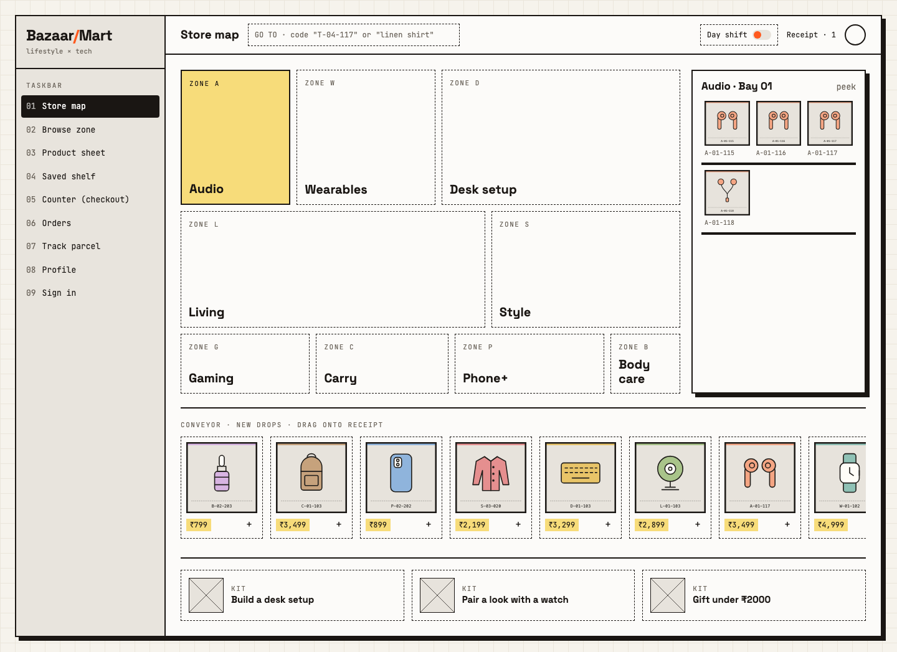

## Getting started

You need Node.js 20 or later and a MongoDB Atlas connection string (or a local MongoDB server).

```bash
npm run install:all
cp backend/.env.example backend/.env
cp frontend/.env.example frontend/.env
```

Fill in `backend/.env`:

| Variable | Required | Purpose |
|---|---|---|
| `MONGO_URI` | Yes | MongoDB connection string. Data is always stored in the `bazaarmart` database. |
| `JWT_SECRET` | Yes | Long random string used to sign login tokens |
| `JWT_EXPIRES_IN` | No | How long a login lasts, default `2h` |
| `SEED_ADMIN_EMAIL` | For seeding | Email of the admin account |
| `SEED_ADMIN_PASSWORD` | For seeding | Password of the admin account, at least 6 characters |
| `SEED_DEMO_EMAIL`, `SEED_DEMO_PASSWORD` | No | Sign-in details for the demo user |
| `NODE_ENV` | No | Set to `production` when deployed |
| `PORT` | No | API port, default `5000` |
| `CLIENT_ORIGIN` | No | Frontend URL allowed by CORS, default `http://localhost:5173` |
| `DNS_SERVERS` | No | Comma-separated DNS servers, only if MongoDB SRV lookups fail on your network |
| `OTP_MOCK` | No | `true` turns on the mock SMS provider. Without it, phone sign-in returns 503 |
| `REQUIRE_AUTH_FOR_CATALOGUE` | No | `true` restores the lab rule that product data needs a login. Default is public |

`frontend/.env` holds one setting, `VITE_API_URL`, the API address ending in `/api`. Catalogue photos are served by the website itself, from `frontend/public/products/`.

The mock SMS provider prints sign-in codes to the server console. `REQUIRE_AUTH_FOR_CATALOGUE=true` makes the product list, category, product sheet, search and kit detail routes return 401 without a token.

Then seed the database and start both apps:

```bash
npm run seed    # syncs indexes, then adds zones, kits, the catalogue, the admin and a demo user
npm run dev     # API on :5000, website on http://localhost:5173
```

The seed is safe to re-run. It adds only what's missing, so product edits and stock levels are kept, and an existing admin keeps their password. Changing `SEED_ADMIN_PASSWORD` later has no effect on that account. If a normal account already holds the admin email, the seed promotes it and replaces its password.

The demo user (`SEED_DEMO_EMAIL`, `SEED_DEMO_PASSWORD`) gets a saved address and two orders, one out for delivery and one packed. It's skipped if those settings are blank. The catalogue is `backend/data/products.json`, 135 products with invented brands, and `backend/data/catalogue.js` holds the zones, kits and demo data. The seed upserts by SKU and keeps the live price and stock of a product that hasn't changed. It removes only the first catalogue's SKUs, so products added on the Admin page stay. Each product has one openly licensed photo where a good one was found: `npm run photos --prefix backend` fetches them from Openverse and Wikimedia Commons, with no account or key. Generated SVGs in `backend/public/products` cover the rest: run `npm run images --prefix backend` after changing the catalogue, then `npm run seed --prefix backend`.

**Photo credits:** author, licence and source for every photo are in [docs/IMAGE_CREDITS.md](docs/IMAGE_CREDITS.md) and on the `/credits` page.

If port 5000 is already in use on macOS, AirPlay Receiver is the usual cause. Set `PORT` in `backend/.env` and `VITE_API_URL` in `frontend/.env` to another port.

## Commands

Run these from the project root.

| Command | What it does |
|---|---|
| `npm run install:all` | Installs root, backend and frontend packages |
| `npm run dev` | Starts the API and the website together |
| `npm run seed` | Adds whatever is missing from the zones, kits, catalogue, admin and demo user |
| `npm test` | Runs the automated tests on temporary in-memory databases |
| `npm run build` | Builds the website into `frontend/dist` |
| `npm start` | Starts the API without auto-reload |

## Catalogue data

The store sells 300 real products from `backend/data/products-300.json`. That file is the source of truth, so never regenerate it over verified data. Each product's price, specs and colours were checked against a real source, recorded in `backend/data/verify/` and `priceNote`.

192 products have a confirmed photo of that exact model. The other 108 show the placeholder, and [image-report.md](backend/data/reports/image-report.md) gives the reason for each one. Every photo is credited on the `/credits` page, under the image on its product sheet, and in [docs/IMAGE_CREDITS.md](docs/IMAGE_CREDITS.md).

To rebuild, run these in order from `backend`:

| Command | What it does |
|---|---|
| `npm run catalogue:verify` | Merges the per-zone records into `products-300.verified.json` |
| `npm run catalogue:images` | Fetches photos and writes `frontend/public/products/*.webp` |
| `npm run catalogue:check` | Runs the automatic photo checks and builds the contact sheets |
| `npm run catalogue:validate` | Checks the data. A missing photo is only a warning |
| `npm run catalogue:credits` | Rewrites `docs/IMAGE_CREDITS.md` |
| `npm run catalogue:import` | Validates, then upserts by SKU. Live stock is kept |
| `npm run catalogue:import -- --dry-run` | Prints what would change and writes nothing |
| `npm run catalogue:import -- --prune-old` | Lists old products with the orders and shelves that use them, then deletes them after you type `yes` |

`npm run seed` uses the same import, but leaves products from this catalogue as they are so Admin edits survive.

Brand and product names are trademarks of their owners. Wikimedia and Openverse photos are CC or public domain, and brand photos are © their owners and are used only for this non-commercial lab demo. If this repo goes public, git-ignore the brand-site and brand-press photos, and `npm run catalogue:images` rebuilds them locally.

These older files are no longer used: `backend/scripts/generateProductImages.js`, `backend/scripts/fetchProductPhotos.js`, `backend/public/products/`, `backend/data/products.json` and `backend/data/product-photos.json`. `backend/data/retiredSkus.json` and `products.json` are still read by `--prune-old`.

## Website pages

| Route | Page | Access |
|---|---|---|
| `/` | Opens the store map | Public |
| `/map` | Store map: tiles sized by stock, peek panel, new-drops conveyor, kits | Public |
| `/zone/:zoneCode` | Browse a zone: filter dials and shelf, list and bench views, all kept in the URL | Public |
| `/p/:sku` | Product sheet: gallery, specs, colours, add, bench, save, fits with, reviews, Q&A | Public |
| `/saved` | Named shelves with share links, price-drop watch and move to receipt | Logged in |
| `/counter` | Counter: three-step checkout on one screen, with a server-priced receipt | Public, guests allowed |
| `/orders` | Timeline of orders with tabs, progress bars, Track, Invoice and Buy again | Logged in |
| `/track/:orderNo` | Simulated route, ETA window, courier, delivery OTP, journey and parcel actions | Owner, or a guest with the order's phone |
| `/track` | Find a guest order by number and phone | Public |
| `/profile` | Member card and six panels: addresses, payments, devices, style, notifications, account | Logged in |
| `/signin` | Phone OTP first, then email login or registration. Google shows that it isn't configured | Public |
| `/s/:shareId` | Read-only shared shelf | Public |
| `/admin/products` | Add, edit and delete products, and advance orders for demos | Admin |

`/login` and `/register` redirect to `/signin`. Every page sits in the same shell: the numbered Taskbar, a top bar with the GO TO box (press `/` to focus it), the Day and Night shift toggle, and the receipt drawer. The theme follows your system until you choose one. Guests keep a receipt in the browser, and it joins your account's receipt when you sign in.

Checkout places a real order and reduces stock, but no payment is taken: UPI, card and netbanking show a simulated confirmation, and no payment details are ever asked for.

Add to the receipt with the `+` on any product, from the product sheet, or by dragging a conveyor card onto **Receipt** in the top bar (mouse or pen; on touch, use `+`). Sign-in by phone needs `OTP_MOCK=true` in `backend/.env`; outside production the code appears on screen and in the server log. The bench holds up to four products and stays in the browser.

## API

The base URL is `/api`. Every response uses this shape, except 204 responses, which have no body:

```json
{ "success": true, "message": "...", "data": {}, "count": 0 }
```

Protected routes need the header `Authorization: Bearer <token>`.

`GET /api/health` needs no login and returns `{ "success": true }`. Use it to check the API is up.

### Users

| Method | Path | Access | Result |
|---|---|---|---|
| POST | `/api/users` | Public | Register: 201, 400, 409 |
| POST | `/api/login` | Public | Returns `data.token` and `data.user`: 200, 400, 401, 404 |
| GET | `/api/users/me` | Logged in | Current user |
| PATCH | `/api/users/me` | Logged in | Like the `?emailId=` PATCH, for phone accounts that have no email. Can add an email once: 200, 400, 409 |
| DELETE | `/api/users/me` | Logged in | Like the `?emailId=` DELETE: 204 |
| PUT | `/api/users?emailId=` | Own account | Full update; needs `username`, `age` and `password` |
| PATCH | `/api/users?emailId=` | Own account | Any of `username`, `age`, `password` |
| DELETE | `/api/users?emailId=` | Own account | Delete account: 204. Shelves go with it, so share links stop working; orders stay on record |

### Phone sign-in

| Method | Path | Access | Result |
|---|---|---|---|
| POST | `/api/auth/otp/request` | Public | `{ "phone": "+919876543210" }`. Sends a 6-digit code valid for 5 minutes; returns it as `data.devCode` outside production. Limited to 5 requests per 10 minutes, per phone and per IP |
| POST | `/api/auth/otp/verify` | Public | `{ "phone", "code" }`. Returns `data.token` and `data.user`, creating the account if new: 200, 400 expired, 401 wrong code, 429 after 5 wrong attempts |
| POST | `/api/auth/google` | Public | 501 until Google sign-in is configured |

### Account details

All of these need a login and affect only your own account.

| Method | Path | Result |
|---|---|---|
| GET, POST | `/api/users/me/addresses` | List, or add: 201. Only one address is the default at a time |
| PUT, DELETE | `/api/users/me/addresses/:id` | Update fields sent: 200, or delete: 204 |
| GET, POST | `/api/users/me/devices` | List, or add: 201 |
| PUT, DELETE | `/api/users/me/devices/:id` | Update fields sent: 200, or delete: 204 |
| GET, POST | `/api/users/me/payment-methods` | List, or add a display label: `{ "type": "upi", "label": "name@bank" }` or `{ "type": "card", "label": "Visa", "last4": "4021" }`. Anything that could be a full card number gets 400 |
| DELETE | `/api/users/me/payment-methods/:id` | Delete: 204 |
| GET, PATCH | `/api/users/me/prefs` | Read, or change only the preferences sent |

### Products

| Method | Path | Access | Result |
|---|---|---|---|
| GET | `/api/products` | Public | List with `count`, sorted by `productId` |
| GET | `/api/products/sheet/:productId` | Public | `data.product` and up to 3 `data.related`; 404 if unknown |
| GET | `/api/products/:category` | Public | Case-insensitive category filter; 404 if none |
| POST | `/api/products` | Admin | Create: 201, duplicate `productId` 409 |
| PUT | `/api/products?productId=` | Admin | Update: 200, 404 |
| DELETE | `/api/products?productId=` | Admin | Delete: 204, 404 |

Both GET routes also accept:

| Parameter | Effect |
|---|---|
| `q` | Search by product name, brand or category |
| `zone`, `brand`, `colour`, `use` | Match any of a comma-separated list, in any case |
| `bay` | Bay number |
| `minPrice`, `maxPrice` | Price range |
| `connectivity` | `wired`, `wireless` or `n/a` |
| `isNew` | `true` or `false` |
| `sort` | `price_asc`, `price_desc`, `new` or `name`; default is `productId` |
| `page`, `limit` | Paginate (`limit` is at most 50) and add a `pagination` object to the response |

### Store browsing

| Method | Path | Access | Result |
|---|---|---|---|
| GET | `/api/zones` | Public | Each zone with `productCount`, `totalStock`, `bays` and `layout` |
| GET | `/api/credits` | Public | Every photo credit, by SKU |
| GET | `/api/search?q=` | Public | Exact SKU first, then matches by name, brand or zone; at most 8; 400 without `q` |
| GET | `/api/kits` | Public | All kits |
| GET | `/api/kits/:id` | Public | `data.kit` and `data.products` |

### Reviews and questions

| Method | Path | Access | Result |
|---|---|---|---|
| GET | `/api/products/:productId/reviews` | Public | Reviews with the writer's username |
| POST | `/api/products/:productId/reviews` | Logged in | `{ "rating", "text" }`: 201; one per user per product, otherwise 409 |
| GET | `/api/products/:productId/questions` | Public | Questions and any answers |
| POST | `/api/products/:productId/questions` | Logged in | `{ "text" }`: 201 |

### Orders

| Method | Path | Access | Result |
|---|---|---|---|
| POST | `/api/orders` | Public or logged in | Place an order: 201, 400, 404, 409 if stock is short |
| POST | `/api/orders/quote` | Public | `{ "items", "coupon" }`. Prices a receipt from the database without saving anything or reserving stock: 200, 400, 404, 409 |
| GET | `/api/orders?status=` | Logged in | Your orders, newest first. `status` is `live`, `delivered`, `returns` or `cancelled` |
| GET | `/api/orders/:orderNo` | Owner or admin | One order |
| GET | `/api/orders/:orderNo/track` | Owner or admin | Events, ETA window and courier, plus the delivery OTP for the owner once out for delivery |
| PATCH | `/api/orders/:orderNo` | Owner | `{ "slot" }`, `{ "leaveAtDoor", "deliveryNote" }` or `{ "cancel": true }`. Cancelling works only before shipping and restores stock |
| GET | `/api/admin/orders?status=` | Admin | Newest 100 orders with the next allowed status, without contact details |
| PATCH | `/api/admin/orders/:orderNo/status` | Admin | `{ "status" }`, one step at a time: 200, 400, 404, 409 |

A checkout body looks like this. Logged-in customers leave out `guest`; for guests it needs a name and phone. On guest orders, pass `?phone=` with the number used at checkout.

```json
{
  "items": [{ "productId": "A-01-103", "qty": 1, "colour": "Sand" }],
  "address": { "name": "Asha", "phone": "9876543210", "line1": "221B Lake Road", "city": "Chennai", "state": "Tamil Nadu", "pincode": "600001" },
  "slot": { "label": "Tomorrow" },
  "payment": { "method": "upi" },
  "coupon": "WELCOME10",
  "gift": { "wrap": true, "note": "Happy birthday" },
  "gst": { "invoice": true, "gstin": "33AAAAA0000A1Z5" },
  "guest": { "name": "Asha", "phone": "9876543210", "email": "asha@example.com" }
}
```

`colour` is optional and must be one the product comes in. Two colours of one product stay as two order lines.

Prices and totals are always calculated on the server from the database. Delivery costs ₹49 below ₹999 and is free from ₹999. Coupon codes are `WELCOME10` (10% off, up to ₹500), `BAZAAR200` (₹200 off from ₹1500) and `FREESHIP`. Payment is simulated: UPI, card and netbanking succeed, and COD stays pending until delivery. Card details are never stored.

### Saved shelves

These need a login and work only on your own shelves, except the public share link.

| Method | Path | Result |
|---|---|---|
| GET, POST | `/api/shelves` | List with live prices, or create from `{ "name" }`: 201 |
| GET, PATCH, DELETE | `/api/shelves/:id` | Read, rename, or delete: 204 |
| POST | `/api/shelves/:id/items` | Save `{ "productId" }` at its current price: 201, 409 if already saved |
| DELETE | `/api/shelves/:id/items/:productId` | Remove: 204 |
| GET | `/api/shelves/shared/:shareId` | Public. Shelf name and items, with no owner details |

Each item shows `savedPrice`, `currentPrice` and `percentChange`.

### Status codes

| Code | Meaning |
|---|---|
| 200 / 201 / 204 | OK / created / done with no content |
| 400 | Invalid input or missing query parameter |
| 401 | Missing or invalid token, or wrong password |
| 403 | Not your account, or admin access required |
| 404 | Not found |
| 409 | Duplicate record, or not enough stock |
| 429 | Too many failed attempts or code requests |
| 500 | Server or database error; the message is generic in production and stack traces are never sent |
| 501 / 503 | Google sign-in or SMS sign-in is not configured |

## Testing

`npm test` runs 308 tests on temporary in-memory databases, covering the API, the data models and the seed script, including two buyers trying to take the last unit at once. `backend/tests/acceptance.test.js` has one named test per line of the acceptance checklists. The first run downloads a temporary MongoDB binary. The checklist audit, with evidence for each line, is in [docs/ACCEPTANCE.md](docs/ACCEPTANCE.md).

### Thunder Client

`docs/api-tests/` holds a collection of 183 requests covering every route and every status code a request can trigger. It uses `{{baseUrl}}`, `{{token}}` and `{{adminToken}}`, and saves tokens and ids as it goes.

1. Run `npm run seed`, and set `OTP_MOCK=true` with `NODE_ENV` not set to production.
2. In Thunder Client, import `thunder-collection_BazaarMart.json` and `thunder-environment_BazaarMart.json`.
3. Set `adminEmail` and `adminPassword` in the environment to your `SEED_ADMIN_EMAIL` and `SEED_ADMIN_PASSWORD`, then run the folders in order.

To replay the same file from the terminal:

```bash
node docs/api-tests/run-collection.mjs http://localhost:5000/api admin@example.com 'admin-password'
```

It cleans up after itself, apart from two order records. The last folder uses up the OTP limit, so wait 10 minutes between runs. Use a development database. Two codes can't be triggered this way: 503 needs `OTP_MOCK` turned off, and 500 needs a database failure. `node docs/api-tests/make-collection.mjs` regenerates the files after an API change.

The older `auth-curl.sh`, `catalogue-curl.sh` and `orders-curl.sh` scripts in the same folder check the same flows with curl. See the top of each file for its arguments.

## Screenshots

| | |
|---|---|
| 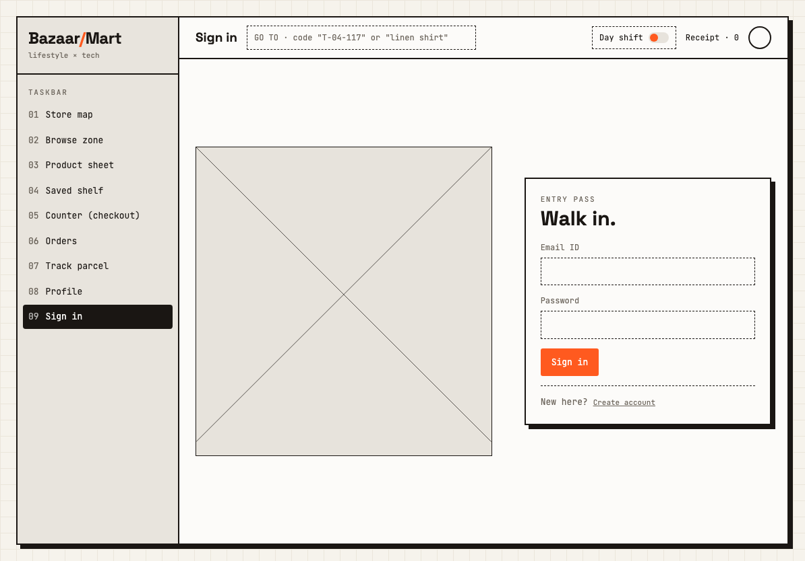 | 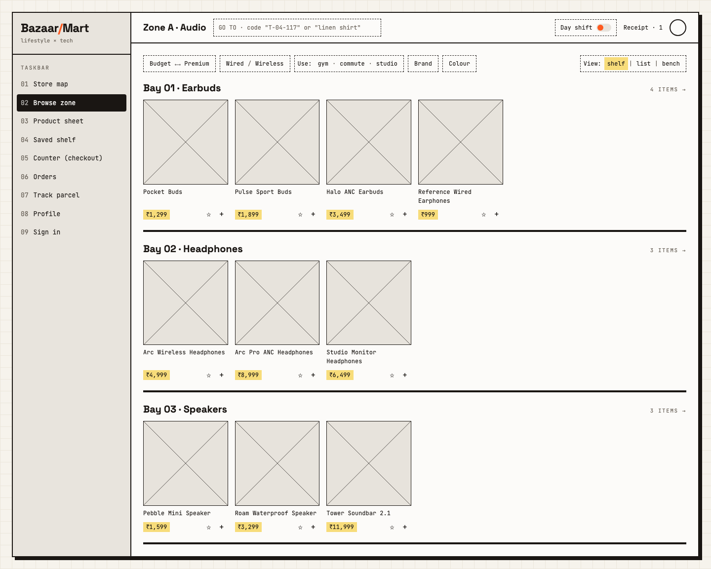 |
| 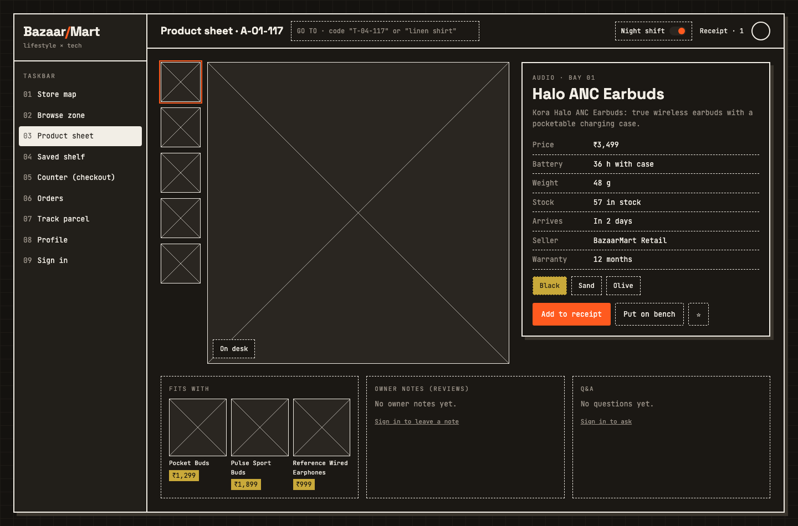 | 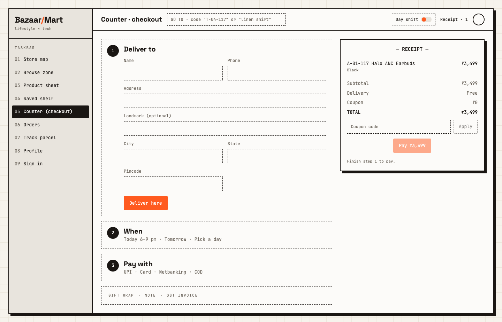 |
| 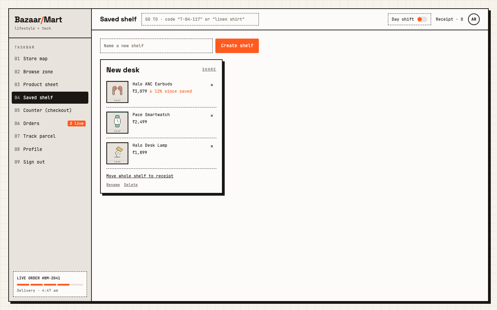 | 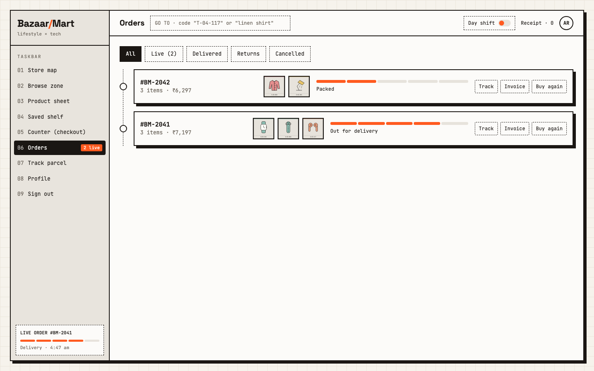 |
| 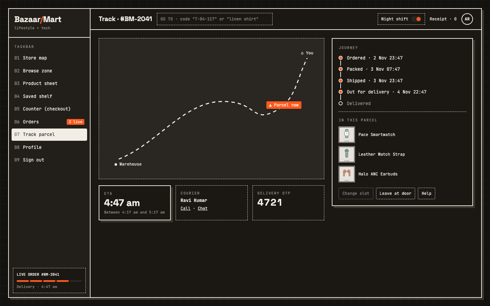 | 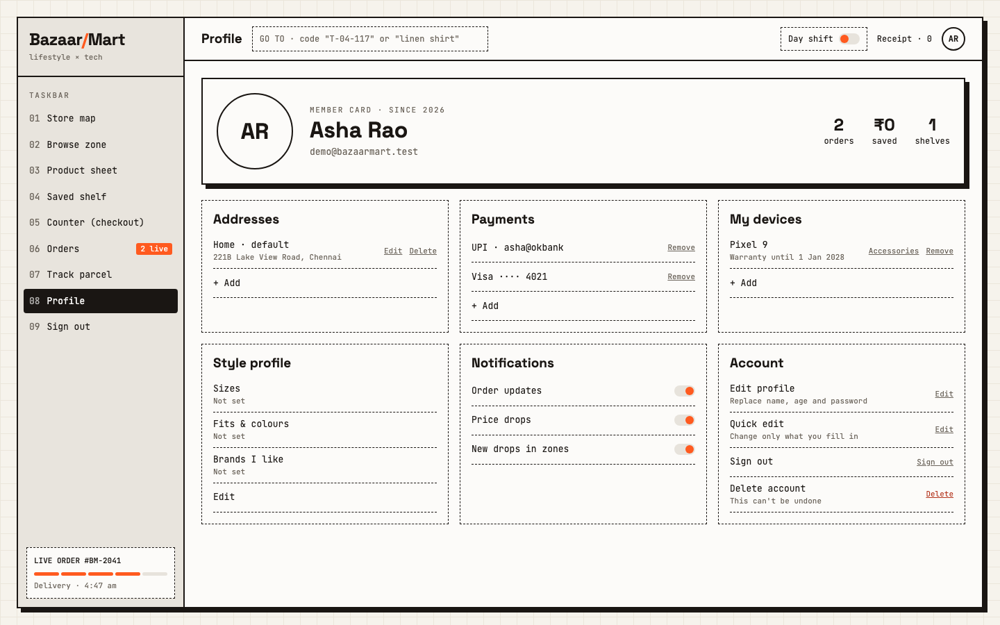 |
| 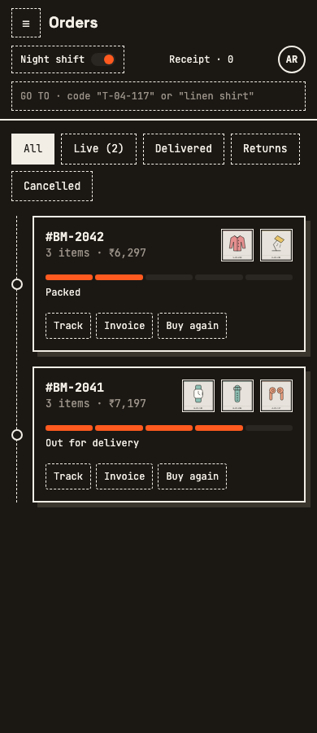 | 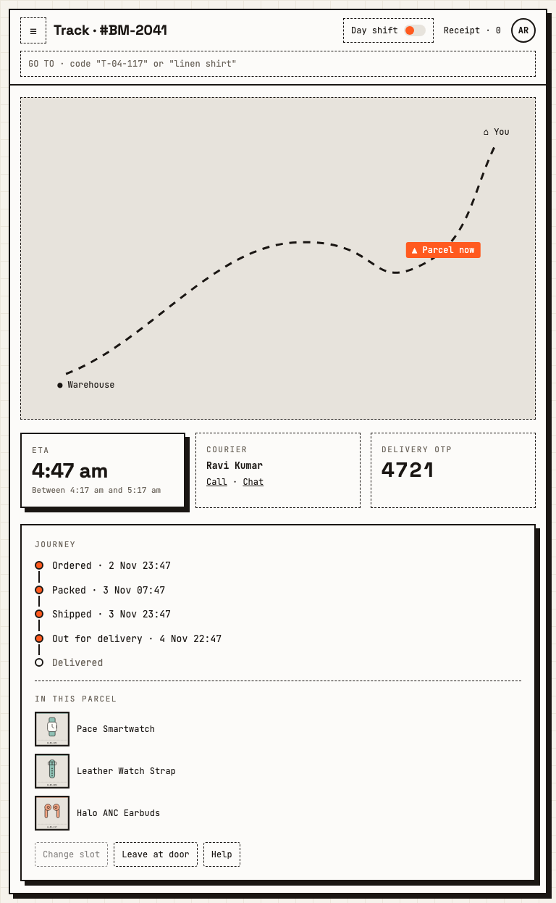 |

## Deployment

The API goes on Render or Railway, the website on Vercel or Netlify, and the database on MongoDB Atlas.

1. **Atlas:** create a cluster and a database user. Under Network Access, allow your host's outbound addresses, or `0.0.0.0/0` for a demo.
2. **Render or Railway:** deploy `backend/` with build command `npm install` and start command `npm start`. Set `NODE_ENV=production`, `MONGO_URI`, a long random `JWT_SECRET`, and `CLIENT_ORIGIN` set to your exact frontend URL with no trailing slash. Add `OTP_MOCK=true` for phone sign-in. In production the code appears only in the server log.
3. **Vercel or Netlify:** deploy `frontend/` with build command `npm run build` and output folder `dist`. Set `VITE_API_URL` to your backend URL followed by `/api`, before the build runs. Add a rewrite that sends all paths to `index.html`, so page refreshes work.
4. **Seed once:** run `npm run seed` from your machine with the production `MONGO_URI`, `SEED_ADMIN_EMAIL` and `SEED_ADMIN_PASSWORD` in `backend/.env`.
5. Open the site, then check `GET /api/health` if the catalogue doesn't load.

## Security notes

- Passwords are hashed with bcrypt and never returned by the API.
- Secrets live only in `backend/.env`, which git ignores.
- Registration can't set a role. Admin accounts come only from the seed script.
- Every token is checked against the database, so a deleted account loses access immediately.
- Prices and totals are always worked out on the server.
- Failed login and registration attempts are limited to 10 per IP address every 15 minutes.
- Guests reach an order only with the phone number used at checkout, and the delivery OTP is shown only to the order's owner.

## Known trade-offs

These are deliberate for a lab project, and a real shop would need to change them.

| Area | What it does now | What a real shop would do |
|---|---|---|
| Login token | The JWT sits in `localStorage`, where any script on the page could read it (an XSS risk) | Use httpOnly cookies |
| Phone OTP | A mock provider prints the code to the server log and, outside production, shows it on screen | Connect a real SMS provider |
| Payments | Simulated. No money moves, and only the method is stored | Connect a payment gateway |
| Saved payment methods | Display labels only, and checkout doesn't use them | Store gateway tokens |
| Route map | A drawn line, with the marker placed by order status | Use real courier GPS |
| Google sign-in | The button shows that it isn't configured (501) | Add OAuth credentials |
| Receipt and bench | Stored per browser, so they don't follow you between devices | Sync them to the account |
| Notifications | The toggles are saved, but nothing is sent yet | Connect email or SMS |
| Q&A | Customers can ask, but there's no screen for answering yet | Add an admin answer route |
| Rate limits | Counted in memory, so they reset on restart and aren't shared between servers | Use a shared store such as Redis |
| Catalogue access | Public by default, which differs from the lab rule | Set `REQUIRE_AUTH_FOR_CATALOGUE=true` to show the lab behaviour |

## Project structure

```
backend/
  server.js        connects to the database and starts the API
  app.js           middleware, routes and error handling
  seed.js          zones, kits, the catalogue, the admin and a demo user
  config/          database connection
  data/            the catalogue, its checks and reports, and the seed data
  models/          User, Product, Zone, Kit, Shelf, Order, Review, Question, Otp, Counter
  middleware/      auth, validation, error handling
  controllers/     request logic
  routes/          URL definitions
  utils/           response, session, pricing and address helpers
  scripts/dataset/ verifies, photographs, validates and imports the catalogue
  tests/           automated tests, including the acceptance suite
frontend/src/
  api/             fetch wrapper
  context/         auth, receipt, bench, theme and notices
  components/      layout, ui, shop, auth, counter, orders, track, profile and admin pieces
  hooks/           shared data and interaction hooks
  pages/           one file per page
  styles/          tokens, base, layout, components and pages
  utils/           invoice download
docs/
  api-tests/       Thunder Client collection, its generator and runner, curl scripts
  screenshots/     screenshots of the website
  wireframe/       the 9 design wireframes
  ACCEPTANCE.md    the checklist audit with evidence
  DESIGN.md        UI and feature specification
```

See [CONTEXT.md](CONTEXT.md) for backend foundations and [docs/DESIGN.md](docs/DESIGN.md) for the UI and new features. Section 10 of DESIGN.md settles any differences.
